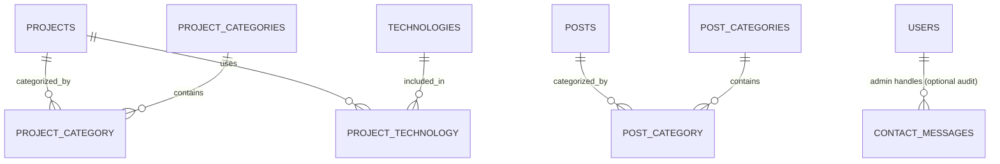

# 05 — Database Schema

> Rancangan konseptual. Tinjau ulang kebutuhan translation, Filament, dan package sebelum membuat migration final.

## Conventions

- Primary key: bigint identity (`id`) kecuali ada kebutuhan lain.
- Timestamp: `created_at`, `updated_at`.
- Slug unik per tabel.
- Foreign key memakai `ON DELETE` sesuai relasi; jangan cascade untuk data penting tanpa pertimbangan.
- Gunakan index pada foreign key, status, slug, published_at, dan kolom filter yang sering dipakai.

## Tables

### users
Akun admin Laravel.
- id
- name
- email (unique)
- password
- is_active (boolean)
- email_verified_at (nullable)
- remember_token
- timestamps

Role/permission mengikuti sistem Filament/authorization yang dipilih. Jangan membuat tabel role custom jika package sudah menyediakan struktur yang sesuai.

### profile_settings
Data profil tunggal dan pengaturan homepage.
- id
- display_name
- headline_id, headline_en
- bio_id, bio_en
- location
- email_public (nullable)
- github_url, linkedin_url, instagram_url (nullable)
- profile_photo_path (nullable)
- cv_file_path (nullable)
- availability_status (boolean)
- seo_title_id, seo_title_en (nullable)
- seo_description_id, seo_description_en (nullable)
- timestamps

### projects
- id
- slug (unique)
- title_id, title_en
- summary_id, summary_en
- description_id, description_en (text)
- role_id, role_en (nullable)
- client_name (nullable; hanya jika boleh dipublikasikan)
- project_url (nullable)
- repository_url (nullable)
- cover_image_path (nullable)
- status (draft/published/archived)
- is_featured (boolean)
- sort_order (integer)
- started_at, completed_at (nullable)
- published_at (nullable)
- seo_title_id, seo_title_en (nullable)
- seo_description_id, seo_description_en (nullable)
- timestamps

### project_categories
- id
- name_id, name_en
- slug (unique)
- timestamps

### project_category (pivot)
- project_id
- project_category_id
- unique composite

### technologies
- id
- name (unique)
- slug (unique)
- icon_key (nullable; whitelist key, bukan HTML)
- website_url (nullable)
- timestamps

### project_technology (pivot)
- project_id
- technology_id
- unique composite

### skills
- id
- name
- category (backend/frontend/database/tools/other)
- description_id, description_en (nullable)
- proficiency_label_id, proficiency_label_en (nullable)
- sort_order
- is_visible
- timestamps

Hindari angka persentase skill yang tidak terukur. Gunakan kategori atau label pengalaman yang jujur.

### experiences
- id
- organization
- position_id, position_en
- description_id, description_en
- location (nullable)
- employment_type (nullable)
- started_at
- ended_at (nullable)
- is_current (boolean)
- sort_order
- is_visible
- timestamps

### certificates
- id
- name_id, name_en (nullable)
- issuer
- credential_id (nullable)
- credential_url (nullable)
- issued_at (nullable)
- expires_at (nullable)
- file_path (nullable)
- image_path (nullable)
- description_id, description_en (nullable)
- is_visible
- timestamps

### posts
- id
- slug (unique)
- title_id, title_en
- excerpt_id, excerpt_en
- content_id, content_en (long text)
- cover_image_path (nullable)
- status (draft/published/archived)
- published_at (nullable)
- seo_title_id, seo_title_en (nullable)
- seo_description_id, seo_description_en (nullable)
- timestamps

### post_categories
- id
- name_id, name_en
- slug (unique)
- timestamps

### post_category (pivot)
- post_id
- post_category_id
- unique composite

### contact_messages
- id
- name
- email
- subject (nullable)
- message (text)
- status (new/read/replied/archived)
- ip_hash (nullable; only if justified)
- created_at
- updated_at

### visitor_events (or daily_visitor_stats)
Choose one strategy:
- Event table for raw, short-retention events; or
- Daily aggregate table for lower storage and privacy impact.

Suggested aggregate:
- id
- event_date
- path
- views_count
- unique_visitors_count (method must be documented)
- referrer_domain (nullable)
- timestamps
- unique composite for dimensions

Do not implement both raw events and aggregate tables unless there is a clear requirement.

### site_settings (optional)
- id
- key (unique)
- value (jsonb)
- timestamps

## Relationships

- Project belongsToMany ProjectCategory.
- Project belongsToMany Technology.
- Post belongsToMany PostCategory.
- Profile settings is a singleton record.
- Admin user may have role/permissions through selected authorization package.
- Contact message is independent.
- Visitor stats are independent aggregate records.

## ERD (conceptual)

The ERD is conceptual; contact handling audit relation is optional and requires an explicit schema decision.

## Index recommendations

- Unique: users.email, projects.slug, posts.slug, category.slug, technology.slug.
- Index: projects(status, published_at), posts(status, published_at), experiences(is_visible, sort_order), skills(is_visible, sort_order), certificates(is_visible, issued_at).
- Add indexes to pivot foreign keys.
- Verify query plans before adding excessive indexes.

## Data lifecycle

- Draft content is not public.
- Archived content is hidden from public routes.
- Contact messages are retained only as long as operationally necessary.
- Analytics follows a documented retention period.
- Uploaded CV and private documents must not be exposed through predictable public paths unless intentionally public.
