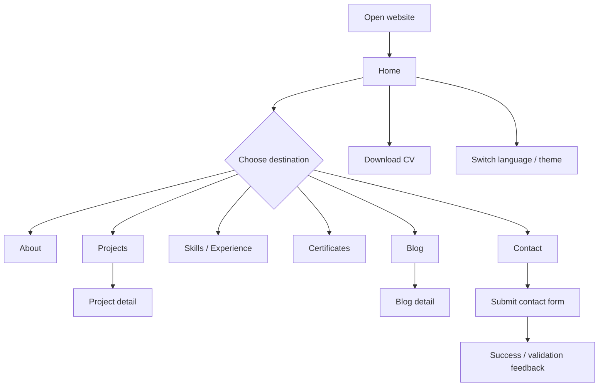
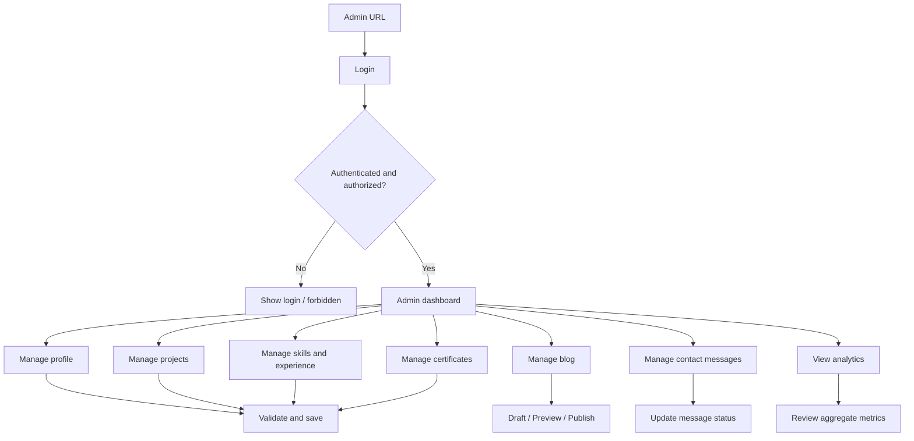

# 07 — User Flow

## Public visitor

## Admin

## Contact flow

1. Visitor mengisi nama, email, subject opsional, dan pesan.
2. Server memvalidasi input.
3. Rate limiter dan anti-spam memeriksa request.
4. Pesan disimpan.
5. Visitor menerima feedback sukses tanpa membocorkan data internal.
6. Admin melihat pesan di CMS.
7. Notifikasi email admin opsional berdasarkan konfigurasi deployment.

## Content publishing flow

1. Admin membuat draft.
2. Admin mengisi konten Indonesia dan Inggris.
3. Admin mengunggah cover/image bila diperlukan.
4. Admin preview tampilan.
5. Admin publish.
6. Konten muncul pada halaman publik jika status dan waktu publikasi memenuhi aturan.

## Language and theme

- Bahasa default: Indonesia atau berdasarkan konfigurasi situs.
- Pengunjung dapat mengganti ke Inggris.
- Theme default mengikuti preferensi sistem pada kunjungan pertama.
- Preferensi disimpan di browser.
